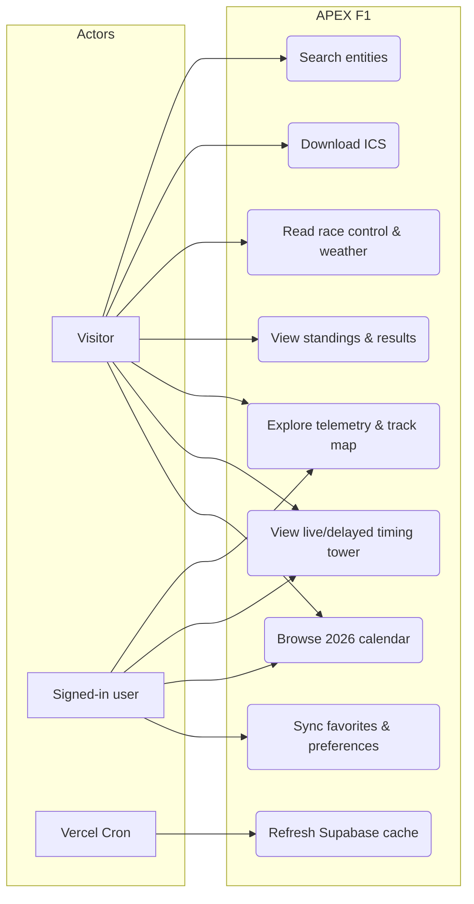
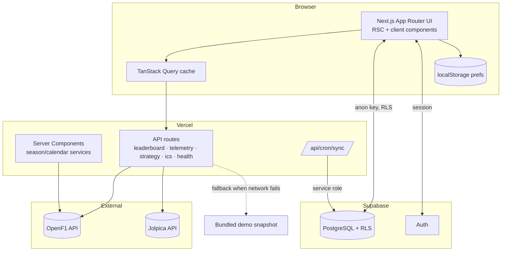
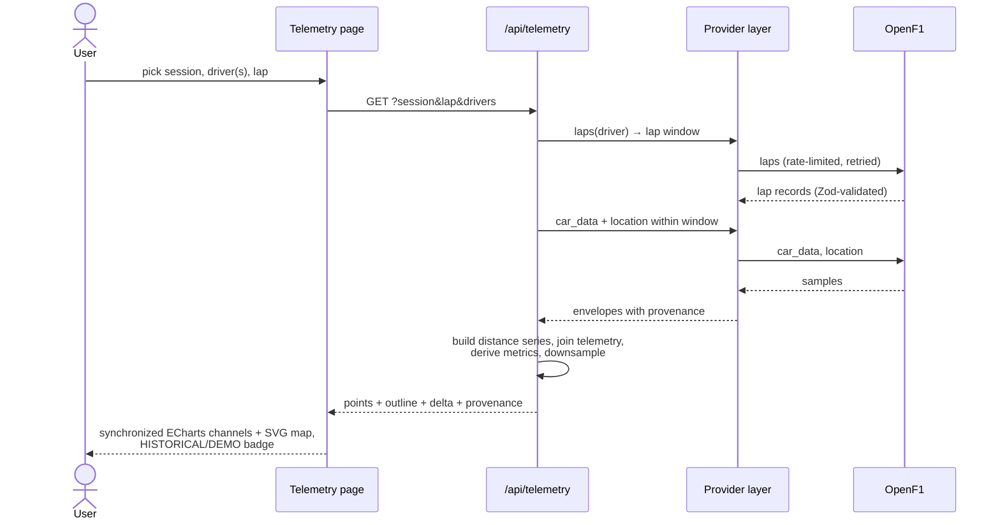
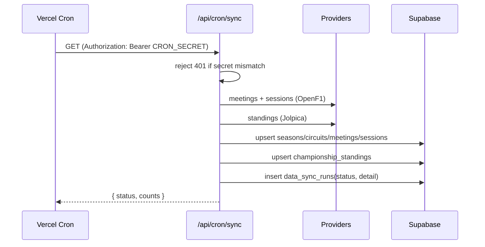
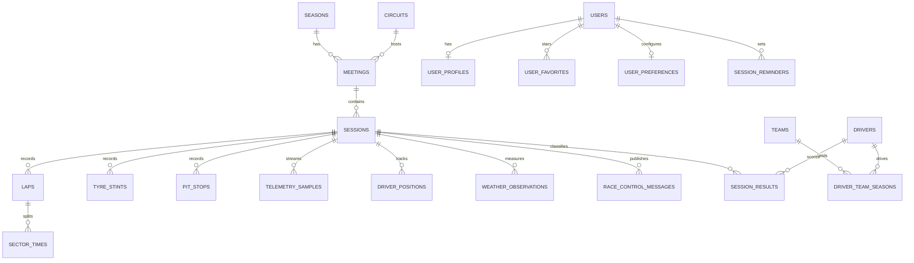

# APEX F1 — Design & Engineering Documentation

This document is the portfolio companion to the codebase: product thinking,
user stories, and the diagrams a reviewer would expect from a professional
project. Everything here reflects what is actually built — when the code
changes, this file changes with it.

## 1. Product framing

**Problem.** F1 data is scattered: the official app is closed, timing data is
locked in broadcast graphics, and open data (OpenF1, Ergast-style APIs) is raw
JSON with no storytelling. Fans and analysts who want to *inspect* a session —
not just watch it — have no good free tool.

**Product.** APEX F1 is a web-based motorsport intelligence terminal: the
information density of a pit-wall timing screen, the polish of a modern data
product, and a strict honesty model about where every number comes from.

**Principles.**

1. *Never fabricate.* No invented timing, no fake "live" clocks, no placeholder
   charts. Missing data is labelled, not papered over.
2. *Provenance everywhere.* Every panel carries a status: LIVE, DELAYED,
   HISTORICAL, DEMO DATA or UNAVAILABLE.
3. *Density with readability.* Monospaced tabular numerals, hairline
   separators, restrained color. Motion only where it carries information.
4. *Anonymous-first.* Everything works signed-out (local preferences); accounts
   add sync, not access.

## 2. Personas & user stories

**Persona A — the race-watcher (Dani).** Watches every race, checks the
calendar mid-week, wants to know when sessions start *in his timezone* and to
see who was fast afterwards.

**Persona B — the data nerd.** Dives into telemetry, compares two drivers over
one lap, exports charts for a blog post.

**Persona C — the reviewer (recruiter/hiring manager).** Opens the site cold,
judges in 60 seconds whether this is real engineering.

| # | As a… | I want… | So that… | Status |
|---|-------|---------|----------|--------|
| US-1 | race-watcher | the full 2026 calendar with session times in track time and my timezone (default Asia/Jakarta) | I never convert times by hand | Built |
| US-2 | race-watcher | a countdown to the next session on the dashboard | I know at a glance what's next | Built |
| US-3 | race-watcher | an .ics download per session or weekend | sessions land in my calendar app | Built |
| US-4 | race-watcher | current championship standings with points progression | I can follow the title fight | Built |
| US-5 | race-watcher | driver and team pages with real 2026 results | I can check form race by race | Built |
| US-6 | data nerd | a timing tower with sector colors (PB/session-best), gaps, tyre and pit info | I can read a session like an engineer | Built |
| US-7 | data nerd | to compare two drivers' telemetry on one lap (speed, throttle, brake, gear, DRS, delta) | I can see exactly where time is won | Built |
| US-8 | data nerd | the circuit outline drawn from recorded GPS with a speed trace | the map is real, not clipart | Built |
| US-9 | data nerd | tyre stint timelines with pit-stop markers | I can read strategy at a glance | Built |
| US-10 | data nerd | race control and measured weather alongside timing | I get the session's context | Built |
| US-11 | anyone | clear LIVE/DELAYED/HISTORICAL/DEMO labels | I can trust what I'm seeing | Built |
| US-12 | anyone | search across drivers, teams, races (keyboard `/`) | I can get anywhere in two keystrokes | Built |
| US-13 | signed-in user | favorites and preferences synced across devices | my setup follows me | Built |
| US-14 | data nerd | shareable telemetry URLs encoding session/drivers/lap | I can send a comparison to a friend | Built |
| US-15 | data nerd | CSV/PNG export of timing and charts | I can reuse the data | Planned |

## 3. Use case diagram



## 4. Architecture diagram



Provider abstraction: `F1DataProvider` (OpenF1), `DemoDataProvider` (bundled
real snapshot), plus Jolpica service functions for results/standings. All
provider payloads are validated with Zod and normalized into shared domain
models wrapped in a provenance `Envelope`.

## 5. Sequence — loading a telemetry comparison



## 6. Sequence — cron ingestion



## 7. Entity-relationship diagram



High-frequency tables (`telemetry_samples`, `driver_positions`) take batched
writes from trusted ingestion only, with documented retention rather than
unbounded growth.

## 8. UI/UX direction & wireframes

Design language: a timing wall, not a landing page. Dark graphite surfaces,
hairline borders, corner-tick panels, uppercase micro-labels, tabular
monospace numerals, one racing-red accent, team colors used only for data
identity. No hero gradients, no glassmorphism, no decorative cards.

Fonts: Space Grotesk (UI/display) + JetBrains Mono (all timing values).

```
DESKTOP — dashboard                         MOBILE
┌────┬──────────────────────────────────┐   ┌─────────────────┐
│ ◤  │ search…                    ☾  👤  │   │ APEX F1    ☾ 👤 │
│ D  ├──────────────────────────────────┤   ├─────────────────┤
│ L  │ SEASON DASHBOARD        [HISTOR.]│   │ NEXT SESSION    │
│ C  │ ┌───────────────┬──────────────┐ │   │ SIN GP Race     │
│ S  │ │ NEXT SESSION  │ WEATHER      │ │   │ 02d 11h 22m     │
│ D  │ │ countdown     │ air/track/…  │ │   ├─────────────────┤
│ T  │ ├───────────────┴──────────────┤ │   │ TIMING TOWER    │
│ T  │ │ TIMING TOWER  (timing wall)  │ │   │ P1 NOR 1:37.5.. │
│ S  │ │ P1 NOR MCL 1:37.599 +0.000  │ │   │ P2 ...          │
│ A  │ │ P2 ...                       │ │   ├─────────────────┤
│ F  │ ├───────────────┬──────────────┤ │   │ RACE CONTROL    │
│    │ │ RACE CONTROL  │ STANDINGS    │ │   └─────────────────┘
│    │ └───────────────┴──────────────┘ │   │ [D][L][C][S][D] │
└────┴──────────────────────────────────┘   └─────────────────┘
```

Telemetry lab: stacked, distance-synchronized channel charts (speed /
throttle / brake / gear / DRS) with a linked crosshair, driver-A/B overlay in
team colors, and a delta strip; the circuit map is drawn from the lap's
recorded GPS points with a speed-colored trace. If no geometry exists for a
session, an explicit notice replaces the map — never a fake outline.

## 9. Testing strategy

- **Unit (vitest)**: leaderboard assembly, timezone conversion, session
  status, lap-time formatting, telemetry join/delta/downsampling, track
  projection, retry/staleness helpers. Current suite: 53 tests.
- **E2E (Playwright)**: dashboard load, calendar navigation, session open,
  driver profile, telemetry lap selection, demo-mode labeling, image
  fallbacks, labelling and credential-free startup. Current suite: 10 specs.
- **CI (GitHub Actions)**: `.github/workflows/ci.yml` runs ESLint, strict
  `tsc`, vitest, a production build and the Playwright suite on every push
  to `main` and every PR; the README badge reflects the latest run.
- **Honesty gate**: no test may assert data we fabricated; demo fixtures are
  real recorded payloads.

## 10. Trade-offs & decisions log

| Decision | Choice | Why |
| --- | --- | --- |
| Live data | Poll OpenF1 free tier, label DELAYED | True streaming needs the paid tier; honesty beats theater |
| Python/FastF1 | Not embedded | Operational complexity of a second runtime; OpenF1 covers the same historical surface via REST |
| Telemetry storage | Not bulk-archived | Retention/cost; app reads provider on demand and caches |
| Demo mode | Bundled real snapshot | Works offline for reviewers; always labelled |
| Auth | Optional Supabase email auth | Anonymous-first product principle |
| Package manager | pnpm | Per project spec |


## Data sources

OpenF1 endpoints used: meetings, sessions, drivers, laps, stints, pit,
position, intervals, car_data, location, weather, race_control,
session_result, starting_grid, overtakes, team_radio. Notes:
- `starting_grid` (beta) has no 2026 rows; race grids fall back to the
  qualifying classification and are labelled "from qualifying".
- `session_result` positions can be non-numeric ("RT"); they are kept as
  unknown rather than coerced. Qualifying durations/gaps arrive as
  per-segment arrays (Q1/Q2/Q3, nullable) and are reduced to the best time.
- `car_data` and `location` are fetched on demand, windowed per lap/driver —
  never bulk-persisted to Supabase (volume vs. free-tier rate limits).
- OpenF1 "no data" arrives as either 200 or 404 with
  `{"detail":"No results found."}`; both map to an honest empty state.
- Championship standings come from Jolpica (more reliable history) rather
  than OpenF1's beta championship endpoints.
